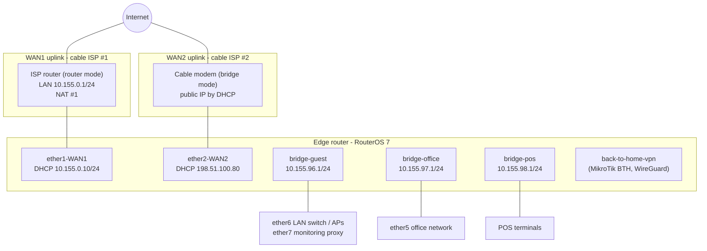

# Multi-WAN with DHCP – PCC load balancing, failover and QoS on MikroTik RouterOS 7

<p align="center">
  <a href="https://buymeacoffee.com/szorfoktato"></a><br>
  If this guide saved you a few hours, you can support the work at <a href="https://buymeacoffee.com/szorfoktato">buymeacoffee.com/szorfoktato</a> ☕
</p>

---

This guidebook documents a working **dual-WAN edge router** for a small business site with three separate LANs:

1. **Two Internet uplinks, both addressed by DHCP.** One is a public address from a cable modem in bridge mode. The other is a private address behind an ISP router (double NAT).
2. **Load balancing** of new connections across both uplinks with **PCC** (Per Connection Classifier), using **separate routing tables** per WAN.
3. **Failover**: each WAN's routing table falls back to the other WAN, and the main table prefers one WAN with the other as backup.
4. **QoS**: per-LAN simple queues with PCQ and priorities. A disabled, older queue-tree design is also covered.
5. **Firewall**: an input/forward policy with a self-learning blacklist (port-scan detection), protection against an open DNS resolver, and management access only through MikroTik's *Back To Home* VPN.

The guide is reverse-engineered from the real configuration. It explains **why** each piece is there and how the pieces interact, and it ends with an honest list of things that do not work as intended today and how to fix them.

> **Privacy note.** Every address, name and identifier in this document is **anonymized**.
> The LANs were moved into `10.155.0.0/16`. The public WAN address is shown as the documentation address `198.51.100.80`. The ISP router's LAN on WAN1 is shown as `10.155.0.0/24`. Old static addresses are shown as `203.0.113.x`. Site, company and ISP names, the remote-support company's address list, MAC addresses, DHCP host names and any credentials were removed. Public anycast DNS resolvers (`1.1.1.1`, `8.8.8.8`, …) are kept, because they are part of the design.

---

## Table of contents

1. [Topology at a glance](#1-topology-at-a-glance)
2. [Interfaces and addressing](#2-interfaces-and-addressing)
3. [The two WANs – both DHCP](#3-the-two-wans--both-dhcp)
4. [Routing tables](#4-routing-tables)
5. [Load balancing with PCC (mangle)](#5-load-balancing-with-pcc-mangle)
6. [Failover](#6-failover)
7. [NAT](#7-nat)
8. [Firewall](#8-firewall)
9. [QoS](#9-qos)
10. [DHCP servers and DNS](#10-dhcp-servers-and-dns)
11. [Packet walks – end-to-end examples](#11-packet-walks--end-to-end-examples)
12. [Configuration reference (sanitized)](#12-configuration-reference-sanitized)
13. [Troubleshooting](#13-troubleshooting)
14. [Review findings and recommended improvements](#14-review-findings-and-recommended-improvements)

---

## 1. Topology at a glance



Plain-text version:

```
                    Internet                                  Internet
                       |                                         |
          +------------+-------------+              +------------+------------+
          | ISP #1 router (NAT #1)   |              | ISP #2 cable modem      |
          | LAN 10.155.0.1/24        |              | bridge mode             |
          +------------+-------------+              +------------+------------+
                       | DHCP 10.155.0.10/24                     | DHCP public 198.51.100.80
                 ether1-WAN1                               ether2-WAN2
          +------------+-----------------------------------------+------------+
          |                       Edge router (RouterOS 7)                    |
          |  PCC 50/50 per connection  ->  routing tables WAN1 / WAN2         |
          |  main table: WAN2 (distance 1), WAN1 (distance 2)                 |
          |  simple queues (PCQ + priority) per LAN                           |
          +------+--------------------+----------------------+----------------+
                 |                    |                      |
          bridge-guest          bridge-office            bridge-pos
          10.155.96.0/24        10.155.97.0/24           10.155.98.0/24
          ether6..ether10       ether5                   (POS terminals)
          (switch, APs, mon.)
```

Key facts:

| Item | Value |
|---|---|
| Uplinks | 2 × cable Internet, both **DHCP clients** on the router |
| Balancing | **PCC** `both-addresses-and-ports:2/0` and `2/1` → each *new connection* is sent out of WAN1 or WAN2 |
| Stickiness | **Connection marks**: once a connection is on a WAN it stays there, including its replies |
| Failover | Per-WAN routing tables with a backup route through the other WAN; main table WAN2 → WAN1 |
| NAT | Masquerade per WAN interface |
| QoS | 3 simple queues (POS / office / guest), PCQ, priorities 2 / 3 / 7 |
| Remote management | MikroTik *Back To Home* VPN only; Winbox from the Internet is blocked |
| Platform | MikroTik RouterOS 7 (`/routing table`, DHCP client `default-route-tables`) |

---

## 2. Interfaces and addressing

### 2.1 Interfaces

| Interface | Role | Notes |
|---|---|---|
| `ether1-WAN1` | WAN1 | DHCP client. Upstream is an ISP router in **router mode** → the router gets a *private* address (double NAT). |
| `ether2-WAN2` | WAN2 | DHCP client. Upstream is a cable modem in **bridge mode** → the router gets the *public* address. |
| `ether5-office` | Office LAN port | Member of `bridge-office` |
| `ether6-LANSWITCH`, `ether7-monitoring`, `ether8`–`ether10` | Guest/site LAN ports | Members of `bridge-guest` (switch, access points, a monitoring proxy) |
| `bridge-guest` | Guest / site LAN | `10.155.96.1/24` |
| `bridge-office` | Office LAN | `10.155.97.1/24` |
| `bridge-pos` | POS (payment terminals) LAN | `10.155.98.1/24` |
| `back-to-home-vpn` | MikroTik BTH (WireGuard-based remote access) | MTU 1420 |

### 2.2 Interface lists

Interface lists keep the firewall and mangle rules independent of port names:

| List | Members |
|---|---|
| `WAN` | `ether1-WAN1`, `ether2-WAN2` |
| `LAN` | `bridge-guest`, `bridge-office`, `bridge-pos` |

(There are also `2 GHz` / `5 GHz` lists left over from earlier wireless interfaces. They are not used.)

### 2.3 Address plan

| Network | Address | Gateway | DHCP pool | Purpose |
|---|---|---|---|---|
| WAN1 (ISP #1 router's LAN) | `10.155.0.10/24` (DHCP) | `10.155.0.1` | – | uplink 1 |
| WAN2 (public) | `198.51.100.80` (DHCP) | ISP gateway (DHCP) | – | uplink 2 |
| Guest / site | `10.155.96.0/24` | `10.155.96.1` | `.50`, `.167–.169`, `.250` (small, partly reserved) | guests, APs, switch, monitoring |
| Office | `10.155.97.0/24` | `10.155.97.1` | `.150–.200`, then `.50–.99` | office PCs, DVR |
| POS | `10.155.98.0/24` | `10.155.98.1` | `.50–.250` | payment terminals |

Using **three separate subnets on three bridges** (rather than one flat LAN) is what makes per-group policy possible: separate queues, separate DHCP options, and (with the fix in §14) separate firewall rules.

---

## 3. The two WANs – both DHCP

### 3.1 Why DHCP on both makes multi-WAN harder

With static WAN addresses you write fixed routes such as `0.0.0.0/0 gateway=203.0.113.1`. With DHCP **the gateway can change at any time**, so you cannot hard-code it. The classic workarounds are scripts in the DHCP client, or routes with `gateway=<interface>`. RouterOS 7 offers a cleaner way: the DHCP client itself can install its default route into **several routing tables, each with its own distance**.

### 3.2 What each DHCP client does here

| DHCP client | Interface | `default-route-tables` (meaning) | Result |
|---|---|---|---|
| `WAN1` | `ether1-WAN1` | `WAN1:1`, `main:2` | default route in table **WAN1** at distance 1, and in **main** at distance **2** (backup) |
| `WAN2` | `ether2-WAN2` | `WAN2:1`, `main:1` | default route in table **WAN2** at distance 1, and in **main** at distance **1** (primary) |

```
/ip dhcp-client
add interface=ether1-WAN1 add-default-route=yes default-route-tables=WAN1:1,main:2 use-peer-dns=no
add interface=ether2-WAN2 add-default-route=yes default-route-tables=WAN2:1,main:1 use-peer-dns=no
```

So the router ends up with, for example:

```
table=main  0.0.0.0/0  gw 198.51.100.1 (ether2-WAN2)  distance 1   <- active
table=main  0.0.0.0/0  gw 10.155.0.1   (ether1-WAN1)  distance 2   <- standby
table=WAN1  0.0.0.0/0  gw 10.155.0.1   (ether1-WAN1)  distance 1
table=WAN2  0.0.0.0/0  gw 198.51.100.1 (ether2-WAN2)  distance 1
```

No script is needed, and when a lease renews with a new gateway, every table is updated automatically.

### 3.3 WAN1 is double-NATed

WAN1's upstream is an ISP router in *router mode*. The edge router only sees `10.155.0.10/24`, and the ISP router NATs again to its own public address. Consequences:

* **Outbound** traffic works normally (masquerade twice).
* **Inbound** connections over WAN1 (port forwards, VPN servers) only work if the ISP router forwards them (DMZ / port forward to `10.155.0.10`).
* Any **failure upstream of the ISP router** (cable down, ISP outage) is **invisible** to the edge router: the link stays up and the gateway `10.155.0.1` still answers. This matters for failover (§6).

WAN2 has the public address directly, so it is the better uplink for inbound services. That is also why it is the **primary** route in the main table.

---

## 4. Routing tables

```
/routing table
add name=WAN1 fib
add name=WAN2 fib
```

A RouterOS 7 routing table is a separate forwarding table. A packet that carries a **routing mark** (`WAN1` or `WAN2`) is looked up **only** in that table. A packet without a mark uses `main`.

Content of the tables:

| Table | Route | Distance | Source | Purpose |
|---|---|---|---|---|
| `main` | `0.0.0.0/0` via WAN2 | 1 | DHCP WAN2 | unmarked traffic and the router's own traffic |
| `main` | `0.0.0.0/0` via WAN1 | 2 | DHCP WAN1 | backup for main |
| `main` | connected LANs and WAN subnets | 0 | connected | local delivery |
| `WAN1` | `0.0.0.0/0` via WAN1 | 1 | DHCP WAN1 | connections balanced to WAN1 |
| `WAN1` | `0.0.0.0/0` via `ether2-WAN2` | **10** | static, "WAN1 Failover → WAN2" | if WAN1 is gone, WAN1-marked traffic leaves via WAN2 |
| `WAN2` | `0.0.0.0/0` via WAN2 | 1 | DHCP WAN2 | connections balanced to WAN2 |
| `WAN2` | `0.0.0.0/0` via `ether1-WAN1` | **10** | static, "WAN2 Failover → WAN1" | if WAN2 is gone, WAN2-marked traffic leaves via WAN1 |

```
/ip route
add dst-address=0.0.0.0/0 gateway=ether2-WAN2 routing-table=WAN1 distance=10 comment="WAN1 Failover -> WAN2"
add dst-address=0.0.0.0/0 gateway=ether1-WAN1 routing-table=WAN2 distance=10 comment="WAN2 Failover -> WAN1"
```

> **Important:** the tables `WAN1` and `WAN2` contain **only default routes**, with no connected LAN routes. Anything that receives a routing mark is sent to the Internet, even if its destination is a local LAN. That is why mangle has to be careful about *what* it marks (§5.4 and §14).

There are also **disabled** routes and tables (`to_ISP1`, `to_ISP2`, routes to `1.1.1.1`, `208.67.220.220`, `8.8.4.4`, `208.67.222.222` with `scope=10`). These are the remains of the **previous design**, which used static public addresses and *recursive* failover. It is explained in §6.4 because it is exactly what the current design is missing.

---

## 5. Load balancing with PCC (mangle)

### 5.1 The idea

Routing alone can't balance stateful traffic well, because if packets of one TCP session leave through two different public IPs, the session breaks. The PCC method works per **connection**:

1. When a connection is **new**, decide which WAN it belongs to and store that decision as a **connection mark**.
2. For **every packet** of that connection, convert the connection mark into a **routing mark**, so it is routed by the right table.
3. Masquerade per WAN interface, so each connection leaves with the matching public IP.

### 5.2 The active mangle rules, in order

| # | Chain | Match | Action | Why |
|---|---|---|---|---|
| 1 | prerouting | `dst-address-type=local` | **accept** ("Bypass Local Traffic") | stop processing for packets addressed to the router itself |
| 2 | prerouting | `in-interface=ether1-WAN1 connection-state=new` | mark-connection `WAN1_conn` | connections that *arrive* on WAN1 must also *reply* via WAN1 |
| 3 | prerouting | `in-interface=ether2-WAN2 connection-state=new` | mark-connection `WAN2_conn` | same for WAN2 |
| 4 | prerouting | `in-interface-list=LAN dst-address-type=!local connection-state=new per-connection-classifier=both-addresses-and-ports:2/0` | mark-connection `WAN1_conn` | half of the new outbound connections → WAN1 |
| 5 | prerouting | same, `…:2/1` | mark-connection `WAN2_conn` | the other half → WAN2 |
| 6 | prerouting | `in-interface-list=LAN connection-mark=WAN1_conn` | mark-routing `WAN1`, passthrough=no | route this packet with table WAN1 |
| 7 | prerouting | `in-interface-list=LAN connection-mark=WAN2_conn` | mark-routing `WAN2`, passthrough=no | route this packet with table WAN2 |
| 8 | output | `dst-address-type=!local connection-mark=WAN1_conn` | mark-routing `WAN1` | the router's *own* replies to WAN1 connections |
| 9 | output | `dst-address-type=!local connection-mark=WAN2_conn` | mark-routing `WAN2` | same for WAN2 |

### 5.3 How PCC decides

`per-connection-classifier=both-addresses-and-ports:2/0` means: *hash source IP + destination IP + source port + destination port, divide by 2, and match if the remainder is 0.* Rule 5 matches remainder 1. Every new connection matches exactly one of the two rules, so each WAN gets ~50 % of the **connections** (not of the bandwidth).

Classifier choices and their trade-offs:

| Classifier | Distribution | Side effect |
|---|---|---|
| `both-addresses-and-ports` (used here) | best spread; one PC uses both WANs at the same time | websites that tie a login session to the client's public IP (banking, some web portals, some VoIP/VPN) can see the client "jump" between two IPs and log out |
| `both-addresses` (used by the disabled old rules) | one client ↔ one server always uses the same WAN | slightly less even spread, far fewer session problems |
| `src-address` | each LAN host is pinned to one WAN | coarse, but the most predictable |

If users report random log-outs on certain sites, switching rules 4–5 to `both-addresses` is the usual fix.

### 5.4 Why the "new"/"LAN"/"!local" conditions matter

* `connection-state=new`: the decision is made **once** per connection. Later packets keep the stored mark, so a connection never moves to another WAN while it is alive.
* `in-interface-list=LAN`: only traffic *from* the LANs is balanced. Traffic arriving from a WAN is handled by rules 2–3.
* `dst-address-type=!local`: packets to the router itself (DNS queries, Winbox from the LAN) are not marked. Otherwise they would be routed out to the Internet.
* What is **not** excluded: traffic **between the local LANs** (guest → office, office → POS). It is not "local" (the destination is a host, not the router), so it gets a WAN mark, and tables WAN1/WAN2 only have default routes. **New inter-LAN connections are therefore sent towards the ISP** instead of to the other bridge. In practice this blocks most inter-LAN traffic by accident. See §14 for the proper fix.

### 5.5 Why inbound connections are marked too (rules 2–3)

Without rules 2–3, a connection that *arrives* on WAN1 (for example a port forward) would be answered according to the main table, which means via WAN2 with the wrong source IP, and the remote side would drop the reply. Marking the connection by its **ingress WAN** makes the replies leave through the same WAN (rules 6–9).

> **Caveat:** rule 1 (`accept dst-address-type=local`) comes **before** rules 2–3. A new connection from the Internet to the router's WAN address (and, before dst-nat, a port-forward) is "local", so it is accepted by rule 1 and **never gets its ingress mark**. The replies then follow the main table (WAN2). This is harmless today, because all port forwards are disabled and WAN input is dropped, but it would break port forwards on WAN1. Move rule 1 below rules 2–3 if you enable inbound services.

### 5.6 Fasttrack and mangle

There is **no fasttrack rule** in this firewall. That matters: fasttracked packets skip mangle **and** queues. If you add fasttrack, both PCC stickiness and the QoS queues lose packets. Either leave it out (as here) or exempt marked connections from it.

---

## 6. Failover

### 6.1 What fails over, and how

| Traffic | Normally | WAN1 down | WAN2 down |
|---|---|---|---|
| Router's own traffic, unmarked | main → WAN2 (d=1) | WAN2 | main → WAN1 (d=2) |
| LAN connections hashed to WAN1 | table WAN1 → WAN1 (d=1) | table WAN1 → backup route via WAN2 (d=10) | WAN1 |
| LAN connections hashed to WAN2 | table WAN2 → WAN2 (d=1) | WAN2 | table WAN2 → backup route via WAN1 (d=10) |

The mechanism is purely **route distance**. When the DHCP-installed route of a WAN disappears, the next route in the table (distance 10, via the other WAN) becomes active. Existing connections on the dead WAN die (their source IP no longer exists). New connections still get PCC marks for both WANs, but both tables now point to the surviving WAN, so **all new traffic flows through the working uplink**. When the WAN returns, its DHCP route reappears with distance 1 and takes over again.

### 6.2 What actually triggers it

A DHCP-installed route is removed when:

* the **Ethernet link goes down** (cable unplugged, modem powered off or rebooting), or
* the **DHCP lease is lost** (the server stops answering until the lease expires), or
* the DHCP client's **gateway check** fails. The client has a gateway-check setting configured; verify that it is `check-gateway=ping`, which removes the route when the gateway stops answering pings.

It is **not** removed when the gateway is alive but the Internet behind it is dead. For WAN1 this is the common failure: the ISP router (`10.155.0.1`) keeps answering ARP, ping and DHCP while its cable line is down, so WAN1 stays "up" and half of all new connections are black-holed until someone notices.

### 6.3 About `gateway=<interface>` in the backup routes

The two backup routes use the **interface** as gateway (`gateway=ether2-WAN2`), because the DHCP gateway address is not known in advance. On an Ethernet interface this means *"ARP for the final destination directly"*. That works only if the upstream device answers ARP for everything (proxy-ARP), which many ISP devices do not. The robust alternative is to let each DHCP client install its route into **both** WAN tables, with different distances (see §14):

```
/ip dhcp-client
set [find interface=ether1-WAN1] default-route-tables=WAN1:1,WAN2:10,main:2
set [find interface=ether2-WAN2] default-route-tables=WAN2:1,WAN1:10,main:1
```

The backup routes then use the real, current gateway IPs, and the two static routes can be deleted.

### 6.4 The previous (disabled) design: recursive failover

The disabled routes show the classic **recursive-route** method that was used when the WANs had static addresses:

```
# "probe" host routes, each pinned to one ISP gateway
/ip route
add dst-address=1.1.1.1/32        gateway=<ISP1-gw> scope=10
add dst-address=208.67.220.220/32 gateway=<ISP1-gw> scope=10
add dst-address=8.8.4.4/32        gateway=<ISP2-gw> scope=10
add dst-address=208.67.222.222/32 gateway=<ISP2-gw> scope=10
# defaults resolved *through* the probe hosts, with check-gateway
add dst-address=0.0.0.0/0 gateway=1.1.1.1        target-scope=11 check-gateway=ping distance=1 routing-table=WAN1
add dst-address=0.0.0.0/0 gateway=208.67.220.220 target-scope=11 check-gateway=ping distance=2 routing-table=WAN1
...
```

Here `check-gateway=ping` pings a host **on the Internet** (`1.1.1.1`) that is reachable *only* through ISP1. If ISP1's line dies anywhere (not just the cable to the modem), the ping fails, the route is disabled, and traffic fails over. **This detects upstream failures**, which the current DHCP-only design cannot do. With DHCP gateways it needs a small DHCP-client script (or `netwatch`) to keep the probe routes' gateways current. See §14 for a ready-to-use variant.

---

## 7. NAT

```
/ip firewall nat
add chain=srcnat action=masquerade out-interface=ether1-WAN1 comment="NAT WAN1"
add chain=srcnat action=masquerade out-interface=ether2-WAN2 comment="NAT WAN2"
add chain=dstnat action=dst-nat in-interface=back-to-home-vpn protocol=tcp dst-port=18295 to-addresses=10.155.96.199 to-ports=8291 comment="Winbox to an AP via BTH"
# + disabled: per-subnet masquerades, port forwards to a DVR, switch, APs, a monitoring proxy
```

Why **per-interface** masquerade and not one rule with `out-interface-list=WAN`? Both work. Per-interface rules make the per-WAN counters visible and let you change one uplink (for example to `src-nat` with a static IP) without touching the other.

Masquerade takes the **current** address of the interface. That is what makes it the right choice for DHCP WANs, and on failover the connection is NATed to the surviving WAN's address automatically.

The only active dst-nat rule is reachable **only from the Back To Home VPN interface**, so it does not expose anything to the Internet. It lets a technician who is connected via BTH open Winbox on an access point in the guest LAN through the router.

---

## 8. Firewall

### 8.1 Input chain (traffic to the router), in order

| # | Rule | Purpose |
|---|---|---|
| 1 | accept `connection-state=established,related` | replies to the router's own connections (DHCP, DNS, BTH, NTP) |
| 2 | accept `in-interface-list=LAN src-address-list=allowed-to-router` | management, DNS and DHCP from the three LANs (`10.155.96.0`–`10.155.98.254`) |
| 3 | accept `protocol=icmp` | ping |
| 4 | drop `in-interface-list=WAN tcp dst-port=8291 src-address-list=!SUPPORT-IPs` | no Winbox from the Internet except from the support company's addresses |
| 5–6 | drop `in-interface-list=WAN udp/tcp dst-port=53` | **the router is a DNS server for the LANs. Without this it would be an open resolver**, abused for DNS amplification attacks |
| 7 | drop `in-interface-list=WAN src-address-list=blacklist` | drop everything from addresses that misbehaved before |
| 10 | add-src-to-address-list `blacklist` (timeout ~1 day): `in-interface-list=WAN tcp psd=21,3s,3,1 src-address-list=!SUPPORT-IPs` | **port-scan detection**: whoever probes many ports quickly is blacklisted |
| 11 | add-src-to-address-list `blacklist` (6 h): `WAN tcp dst-port=20-1023,8000,8080,8192`, not from support | anyone who touches common service ports is blacklisted |
| 12 | add-src-to-address-list `blacklist` (6 h): `WAN udp dst-port=20-122,124-1023,8000,8080,8192`, not from support | same for UDP; **port 123 (NTP) is deliberately left out** so NTP replies can't blacklist time servers |
| 13 | accept icmp | (duplicate of 3, harmless) |
| 22–23 | *disabled:* accept Winbox on a custom port, accept OpenVPN | old remote access, replaced by BTH |
| 27 | **drop `in-interface-list=WAN`** | default deny from the Internet |

How the blacklist works: rules 10–12 only **add** the source to the `blacklist` address list (they don't drop anything themselves). The packet then reaches rule 27 and is dropped. From then on, **every** packet from that source, including in `forward`, is dropped early by rule 7 / forward rule 3, until the list entry times out. It is a cheap, self-learning IPS.

> **Note on rule 4:** because rule 27 drops all WAN input anyway, rule 4 only matters if someone later adds an "accept Winbox" rule. The disabled rule 22 shows that the intent was to allow Winbox only from the support company's IPs. Today, remote management goes through **Back To Home**: the router builds the BTH tunnel *outbound*, so no inbound port has to be open.

### 8.2 Forward chain (traffic through the router), in order

| # | Rule | Purpose |
|---|---|---|
| 1 | accept `connection-state=established,related` | return traffic |
| 2 | drop `in-interface-list=WAN src-address-list=blacklist` | blacklisted sources can't reach the LANs either |
| 3 | drop `connection-state=invalid` | hygiene |
| 4–12 | *disabled:* accept to the DVR, switch and APs (port forwards) | port forwards are currently off |
| 13 | **drop `in-interface-list=WAN`** | nothing from the Internet gets into the LANs unless explicitly allowed |

Everything else (LAN → Internet, LAN → LAN) is **allowed by default**, because nothing drops it.

> **Rule-order nit:** "accept established,related" comes before "drop invalid". That is fine. Invalid packets are never "established", so they still reach the drop rule.

### 8.3 What this firewall does **not** do

* **No isolation between guest, office and POS.** The forward chain has no LAN-to-LAN restriction. The only reason inter-LAN connections mostly fail today is the PCC side effect in §5.4, and that is accidental. A guest device should never be able to reach payment terminals or office PCs. See §14 for explicit rules.
* **No IPv6 policy** is configured. Make sure IPv6 is disabled, or add an IPv6 firewall, if either ISP starts delegating prefixes.

---

## 9. QoS

### 9.1 Active configuration: three simple queues

| Queue (order) | Target | Priority (up/down) | Queue type (up/down) | max-limit |
|---|---|---|---|---|
| `POS` | `10.155.98.0/24` | **2 / 2** | `pcq-upload-default` / `pcq-download-default` | not set |
| `Office` | `10.155.97.0/24` | **3 / 3** | PCQ / PCQ | not set |
| `Guest` | `10.155.96.0/24` | **7 / 7** | PCQ / PCQ | not set |

The intent is clear: **payment terminals first, office second, guests last**, with **PCQ** sharing each group's bandwidth fairly between its hosts:

* `pcq-upload-default` classifies by **source** address, so every guest gets an equal share of the upload.
* `pcq-download-default` classifies by **destination** address, so every guest gets an equal share of the download.

### 9.2 Why it currently has (almost) no effect

QoS can only reorder traffic **when there is a queue to reorder**, which means when the router itself is the bottleneck. Two details stop that from happening here:

1. **No `max-limit`** is set on any queue, and there is no parent queue with a limit. HTB *priority* is only used to decide which **sibling** gets spare capacity **under a limited parent**. With no limit anywhere, every queue is always "within limit", so priority is never consulted.
2. **PCQ with `rate=0`** (the default types) means "unlimited per host". With no overall limit, it never has to share anything.

The real bottleneck is the **ISP modem's upload buffer**. When a guest saturates the upload, latency rises for the POS terminals too, and the router doesn't intervene. The queues still give useful **per-group traffic statistics** (Winbox → Queues), which is worth something.

### 9.3 How to make it work: a parent with a limit

Put the three groups under one parent that is slightly **below** the real uplink capacity, so the queue builds up on the router (where priorities apply) instead of in the modem:

```
/queue simple
add name=total target=10.155.96.0/24,10.155.97.0/24,10.155.98.0/24 \
    max-limit=<UP_total*0.9>/<DOWN_total*0.9> queue=default/default
add name=POS    parent=total target=10.155.98.0/24 priority=2/2 limit-at=2M/2M \
    max-limit=<UP_total*0.9>/<DOWN_total*0.9> queue=pcq-upload-default/pcq-download-default
add name=Office parent=total target=10.155.97.0/24 priority=3/3 limit-at=<guaranteed> \
    max-limit=<UP_total*0.9>/<DOWN_total*0.9> queue=pcq-upload-default/pcq-download-default
add name=Guest  parent=total target=10.155.96.0/24 priority=7/7 limit-at=1M/5M \
    max-limit=<cap for guests> queue=pcq-upload-default/pcq-download-default
```

* `limit-at` = guaranteed rate, `max-limit` = ceiling. Priority decides who gets the capacity **between** limit-at and max-limit.
* With **two WANs** the usable capacity is roughly the sum, but per-WAN congestion still happens (PCC spreads connections, not bytes). For strict per-uplink shaping, use a **queue tree** on each WAN interface instead of simple queues.
* Optionally set a per-host cap on guests with a custom PCQ type, for example `pcq-rate=10M classifier=dst-address`.
* Keep fasttrack **off** (or exclude these subnets), otherwise the queues are bypassed.

### 9.4 The older, disabled QoS design (for reference)

The configuration still contains a disabled, classic **mangle + queue tree** setup:

```
mangle:  mark-connection client_dw_conn / client_up_conn   (by interface)
         mark-packet     clien_dw_pk / client_up_pk         (from those connections)
         mark-packet     http_dw_pk / http_up_pk            (tcp 80,443)
         mark-packet     p2p_dw_pk / p2p_up_pk              (p2p matcher)
         mark-packet     other_dw_pk / other_up_pk          (everything else)
queue tree (parent=global):
  All bandwidth ─┬─ Download (max 500M) ─┬─ HTTP_dw   prio 1
                 │                       ├─ other dw  prio 6
                 │                       └─ p2p_dw    max 200M
                 └─ UP (max 22M) ─────────┬─ HTTP_up   prio 1
                                          ├─ other_up  prio 6, max 15M
                                          └─ p2p_up    max 5M
```

This *did* have limits, so priorities worked. It is disabled, probably because:

* RouterOS 7 removed the `p2p` matcher, so the p2p classes no longer match anything;
* "HTTP/HTTPS = priority 1" means almost all modern traffic is priority 1, so it no longer separates anything useful;
* a single global tree doesn't know about two WANs.

The per-group simple queues in §9.3 are the better replacement.

---

## 10. DHCP servers and DNS

| Server | Interface | Pool | DNS handed out | Lease |
|---|---|---|---|---|
| `dhcp-guest` | `bridge-guest` | guest pool (small, with static leases for infrastructure) | `10.155.96.1`, `1.1.1.1`, `8.8.8.8` | 10 min |
| `dhcp-office` | `bridge-office` | `.150–.200` → next pool `.50–.99` | `10.155.97.1`, `8.8.8.8` | 10 min |
| `dhcp-pos` | `bridge-pos` | `.50–.250` | `10.155.98.1`, `8.8.8.8` | 10 min |

* The office pool is **chained** (`next-pool`): when `.150–.200` runs out, addresses come from `.50–.99`.
* The router's **DNS resolver** uses `1.1.1.1` and `8.8.8.8` as upstream servers, with `allow-remote-requests=yes`. That's why input rules 5–6 (§8.1) are essential.
* The DHCP clients use their **own** upstream DNS servers (not the ISPs'). This is good with two WANs, because public resolvers work over either uplink, while an ISP's resolver often refuses queries from the other ISP's address.
* Short **10-minute leases** let devices move between subnets quickly and keep stale entries short, at the cost of more DHCP traffic (negligible).

---

## 11. Packet walks – end-to-end examples

### 11.1 Office PC opens `https://example.org`

1. `10.155.97.20:51000 → 93.184.216.34:443`, SYN, arrives on `bridge-office` (LAN list).
2. Mangle rule 1: destination is not local, continue. Rules 2–3: not from a WAN. Rule 4 or 5: PCC hash → say remainder 1 → `connection-mark=WAN2_conn`.
3. Rule 7: `routing-mark=WAN2`.
4. Routing: table WAN2 → `0.0.0.0/0` via WAN2 gateway (distance 1).
5. Queue `Office` (upload) counts the packet.
6. Forward chain: not from WAN, not invalid → allowed (no drop rule matches).
7. srcnat: out `ether2-WAN2` → masquerade to `198.51.100.80`.
8. Reply arrives on WAN2: conntrack un-NATs, forward rule 1 (established) accepts, queue `Office` (download) counts it, delivered.
9. Every later packet of this connection carries `WAN2_conn`, so it always uses table WAN2.

### 11.2 Same, but WAN2's modem is switched off

1. `ether2-WAN2` goes link-down → the DHCP routes in `main` and `WAN2` disappear.
2. New connection hashed to WAN2 → table WAN2 now only has `0.0.0.0/0 gateway=ether1-WAN1 distance=10` → leaves via WAN1 and is masqueraded to `10.155.0.10`, then NATed again by the ISP router.
3. New connections hashed to WAN1 → table WAN1 (unchanged).
4. Router's own traffic → main → WAN1 (distance 2).
5. Connections that were already on WAN2 are lost. Clients reconnect and get WAN1.

### 11.3 Same, but ISP #1's cable is cut (link to its router still up)

1. Link up, DHCP lease valid, gateway `10.155.0.1` answers → **no route change**.
2. ~50 % of new connections still go to WAN1 and time out. Users see "every second page doesn't load".
3. This is the gap that §6.4 / §14 (recursive check) closes.

### 11.4 Guest phone tries to reach an office PC `10.155.97.20`

1. New connection from `bridge-guest`, destination not local → PCC marks it `WAN1_conn` or `WAN2_conn`.
2. Routing mark → table WAN1/WAN2 → only a default route → **sent to the ISP**, masqueraded, and dropped somewhere upstream.
3. Result: no connection. It *looks* like isolation, but it is a side effect. A device that sends traffic in an unusual way, or a future mangle change, would reach the office directly. Use explicit firewall rules (§14).

---

## 12. Configuration reference (sanitized)

Only the relevant parts, in RouterOS 7 export syntax.

```
# --- Interfaces / bridges ---
/interface bridge
add name=bridge-guest
add name=bridge-office
add name=bridge-pos
/interface bridge port
add bridge=bridge-guest  interface=ether6-LANSWITCH
add bridge=bridge-guest  interface=ether7-monitoring
add bridge=bridge-guest  interface=ether8
add bridge=bridge-guest  interface=ether9
add bridge=bridge-guest  interface=ether10
add bridge=bridge-office interface=ether5-office
/interface list
add name=WAN
add name=LAN
/interface list member
add list=WAN interface=ether1-WAN1
add list=WAN interface=ether2-WAN2
add list=LAN interface=bridge-guest
add list=LAN interface=bridge-office
add list=LAN interface=bridge-pos

# --- Addressing ---
/ip address
add interface=bridge-guest  address=10.155.96.1/24
add interface=bridge-office address=10.155.97.1/24
add interface=bridge-pos    address=10.155.98.1/24

# --- Routing tables + WAN DHCP ---
/routing table
add name=WAN1 fib
add name=WAN2 fib
/ip dhcp-client
add interface=ether1-WAN1 comment=WAN1 add-default-route=yes default-route-tables=WAN1:1,main:2 use-peer-dns=no
add interface=ether2-WAN2 comment=WAN2 add-default-route=yes default-route-tables=WAN2:1,main:1 use-peer-dns=no
/ip route
add dst-address=0.0.0.0/0 gateway=ether2-WAN2 routing-table=WAN1 distance=10 comment="WAN1 Failover -> WAN2"
add dst-address=0.0.0.0/0 gateway=ether1-WAN1 routing-table=WAN2 distance=10 comment="WAN2 Failover -> WAN1"

# --- PCC load balancing ---
/ip firewall mangle
add chain=prerouting dst-address-type=local action=accept comment="Bypass Local Traffic"
add chain=prerouting in-interface=ether1-WAN1 connection-state=new action=mark-connection new-connection-mark=WAN1_conn
add chain=prerouting in-interface=ether2-WAN2 connection-state=new action=mark-connection new-connection-mark=WAN2_conn
add chain=prerouting in-interface-list=LAN dst-address-type=!local connection-state=new \
    per-connection-classifier=both-addresses-and-ports:2/0 action=mark-connection new-connection-mark=WAN1_conn
add chain=prerouting in-interface-list=LAN dst-address-type=!local connection-state=new \
    per-connection-classifier=both-addresses-and-ports:2/1 action=mark-connection new-connection-mark=WAN2_conn
add chain=prerouting in-interface-list=LAN connection-mark=WAN1_conn action=mark-routing new-routing-mark=WAN1 passthrough=no
add chain=prerouting in-interface-list=LAN connection-mark=WAN2_conn action=mark-routing new-routing-mark=WAN2 passthrough=no
add chain=output dst-address-type=!local connection-mark=WAN1_conn action=mark-routing new-routing-mark=WAN1
add chain=output dst-address-type=!local connection-mark=WAN2_conn action=mark-routing new-routing-mark=WAN2

# --- NAT ---
/ip firewall nat
add chain=srcnat out-interface=ether1-WAN1 action=masquerade comment="NAT WAN1"
add chain=srcnat out-interface=ether2-WAN2 action=masquerade comment="NAT WAN2"

# --- Firewall ---
/ip firewall address-list
add list=allowed-to-router address=10.155.96.0-10.155.98.254
add list=SUPPORT-IPs address=support.example.net
/ip firewall filter
add chain=input   action=accept connection-state=established,related
add chain=forward action=accept connection-state=established,related
add chain=input   action=accept in-interface-list=LAN src-address-list=allowed-to-router
add chain=input   action=accept protocol=icmp
add chain=input   action=drop in-interface-list=WAN protocol=tcp dst-port=8291 src-address-list=!SUPPORT-IPs
add chain=input   action=drop in-interface-list=WAN protocol=udp dst-port=53
add chain=input   action=drop in-interface-list=WAN protocol=tcp dst-port=53
add chain=input   action=drop in-interface-list=WAN src-address-list=blacklist comment="drop blacklist"
add chain=forward action=drop in-interface-list=WAN src-address-list=blacklist comment="drop blacklist"
add chain=forward action=drop connection-state=invalid
add chain=input   action=add-src-to-address-list address-list=blacklist address-list-timeout=1d \
    in-interface-list=WAN protocol=tcp psd=21,3s,3,1 src-address-list=!SUPPORT-IPs comment="port scanners"
add chain=input   action=add-src-to-address-list address-list=blacklist address-list-timeout=6h \
    in-interface-list=WAN protocol=tcp dst-port=20-1023,8000,8080,8192 src-address-list=!SUPPORT-IPs
add chain=input   action=add-src-to-address-list address-list=blacklist address-list-timeout=6h \
    in-interface-list=WAN protocol=udp dst-port=20-122,124-1023,8000,8080,8192 src-address-list=!SUPPORT-IPs
add chain=forward action=drop in-interface-list=WAN comment="Drop all"
add chain=input   action=drop in-interface-list=WAN comment="Drop all"

# --- QoS (as configured – see 9.3 for a version with limits) ---
/queue simple
add name=POS    target=10.155.98.0/24 priority=2/2 queue=pcq-upload-default/pcq-download-default
add name=Office target=10.155.97.0/24 priority=3/3 queue=pcq-upload-default/pcq-download-default
add name=Guest  target=10.155.96.0/24 priority=7/7 queue=pcq-upload-default/pcq-download-default

# --- DHCP / DNS ---
/ip pool
add name=pool-office2 ranges=10.155.97.50-10.155.97.99
add name=pool-office  ranges=10.155.97.150-10.155.97.200 next-pool=pool-office2
add name=pool-pos     ranges=10.155.98.50-10.155.98.250
/ip dhcp-server
add name=dhcp-office interface=bridge-office address-pool=pool-office lease-time=10m
add name=dhcp-pos    interface=bridge-pos    address-pool=pool-pos    lease-time=10m
/ip dhcp-server network
add address=10.155.96.0/24 gateway=10.155.96.1 dns-server=10.155.96.1,1.1.1.1,8.8.8.8
add address=10.155.97.0/24 gateway=10.155.97.1 dns-server=10.155.97.1,8.8.8.8
add address=10.155.98.0/24 gateway=10.155.98.1 dns-server=10.155.98.1,8.8.8.8
/ip dns
set servers=1.1.1.1,8.8.8.8 allow-remote-requests=yes
```

---

## 13. Troubleshooting

| Check | Command | Healthy result |
|---|---|---|
| Both WANs have a lease | `/ip dhcp-client print detail` | `status=bound` on both, gateways filled in |
| Routes per table | `/ip route print where dst-address=0.0.0.0/0` | main: WAN2 active (d=1), WAN1 standby (d=2). WAN1/WAN2 tables: DHCP route active (d=1), failover (d=10) inactive |
| Each WAN actually reaches the Internet | `/ping 1.1.1.1 routing-table=WAN1` and `… routing-table=WAN2` | replies on both. **This is the test that finds a dead upstream behind a live gateway** |
| PCC split | `/ip firewall mangle print stats` | the two PCC rules have similar packet counters |
| Connections per WAN | `/ip firewall connection print count-only where connection-mark=WAN1_conn` (and `WAN2_conn`) | similar numbers |
| Which WAN a client uses | `/ip firewall connection print where src-address~"10.155.97.20"` | `connection-mark` and `reply-dst-address` show the WAN |
| NAT per WAN | `/ip firewall nat print stats` | both masquerade rules count |
| Blacklist | `/ip firewall address-list print where list=blacklist` | scanners appear with a timeout |
| Queues | `/queue simple print stats` | rates per group. With no max-limit, `queued-packets` is always 0 |
| Public IP per WAN | from a LAN PC, open "what is my IP" several times | both public IPs appear (with `both-addresses-and-ports`) |

Typical faults:

* **"Every second website doesn't load":** one WAN is dead upstream, but its gateway is alive. Ping per table to confirm, then add the recursive check from §14.
* **Users get logged out of banking or web portals:** PCC `both-addresses-and-ports` changes the public IP between connections. Switch to `both-addresses`.
* **Printer / DVR in another LAN unreachable:** the inter-LAN traffic got a WAN routing mark (§5.4). Add the local-subnets bypass (§14), and then allow exactly what is needed in the firewall.
* **Port forward on WAN1 doesn't work:** double NAT (forward it on the ISP router first) **and** the mangle order caveat in §5.5.
* **QoS "does nothing":** expected without a `max-limit` (§9.2).

---

## 14. Review findings and recommended improvements

| # | Area | Finding | Recommendation |
|---|---|---|---|
| 1 | Failover | Failover only reacts to link-down / lost lease / dead gateway. An outage **behind** the ISP router (WAN1) or beyond the CMTS (WAN2) is not detected. Half of all new connections are then black-holed. | Add an Internet reachability check per WAN. Simplest RouterOS 7 option: `netwatch` with `type=icmp` towards a host pinned to each WAN by a /32 route, which disables/enables that WAN's DHCP client routes (or sets a high distance). Alternatively use the recursive-route method from §6.4 and update the probe routes' gateways from the DHCP client `script`. |
| 2 | Failover | The backup routes use `gateway=<interface>` on Ethernet, which relies on proxy-ARP upstream. | Use `default-route-tables=WAN1:1,WAN2:10,main:2` / `WAN2:1,WAN1:10,main:1` on the DHCP clients and delete the two static backup routes. |
| 3 | Failover | Verify the DHCP clients' gateway check. | `check-gateway=ping` on both DHCP clients, so a dead gateway removes the route within seconds. |
| 4 | PCC | Inter-LAN traffic is load-balanced to the Internet (no connected routes in the WAN tables). | Add before the PCC rules: `/ip firewall address-list add list=LOCAL-NETS address=10.155.96.0/22` (or one entry per LAN) and `/ip firewall mangle add chain=prerouting dst-address-list=LOCAL-NETS action=accept place-before=…`. Then control inter-LAN access in the **filter** (finding 6). |
| 5 | PCC | "Bypass Local Traffic" is placed **before** the ingress-WAN connection marks, so inbound connections to the router (and port forwards) are not marked with their WAN. | Move the two `in-interface=etherX-WANx connection-state=new` rules to the top of prerouting. |
| 6 | Firewall | **No isolation** between guest, office and POS. | Add before the final rules: `add chain=forward action=drop in-interface=bridge-guest out-interface-list=LAN comment="guest isolation"` and `add chain=forward action=drop out-interface=bridge-pos in-interface=!bridge-pos comment="POS isolation"`, plus specific accepts for anything that must cross (for example office → DVR). For a payment network this is close to mandatory (PCI DSS segmentation). |
| 7 | Firewall | Guests can open the router's management (Winbox, WebFig, SSH) because `allowed-to-router` includes the guest subnet. | Allow only DNS (53), DHCP (67) and ICMP from the guest and POS bridges, and full management only from the office (or a dedicated management list). |
| 8 | Firewall | No IPv6 firewall. | Disable IPv6 (`/ipv6 settings set disable-ipv6=yes`) or apply the default IPv6 firewall. |
| 9 | Firewall | Rule 4 (Winbox from WAN except support) has no effect behind the final drop, and disabled Winbox/OpenVPN rules remain. | Keep BTH as the only remote access and remove the dead rules for clarity. If the support company needs direct access, add an explicit `accept src-address-list=SUPPORT-IPs dst-port=<custom>` instead. |
| 10 | QoS | Simple queues have priorities but **no max-limit / parent**, so priorities never apply. | Use the parent/child structure in §9.3 with limits around 90 % of the real line rates. Keep fasttrack off. |
| 11 | QoS | The old queue tree uses the `p2p` matcher (removed in RouterOS 7). | Delete the disabled tree and its mangle marks, or rebuild it per WAN interface without p2p classes. |
| 12 | PCC | `both-addresses-and-ports` can break IP-bound sessions. | If users complain, switch to `both-addresses`. |
| 13 | DHCP | Some guest pool ranges are tiny single-address ranges (leftovers from static assignments). | Use static leases for infrastructure, and one contiguous pool for guests. |
| 14 | Hygiene | Many disabled leftovers: old static-IP routes and addresses, recursive routes, the `to_ISP1/2` tables, the old mangle QoS, port forwards, an OpenVPN pool. | Export a backup, then remove them. Smaller configs are easier to audit, and §6.4 already documents the old design. |
| 15 | Monitoring | A monitoring proxy sits in the guest LAN. | Move infrastructure (switch, APs, monitoring) to a separate management subnet/VLAN, not the guest network. |

### Bonus: a WAN health check with netwatch (template)

```
# pin one probe host per WAN (does not need the DHCP gateway: uses the WAN tables)
/ip route
add dst-address=1.0.0.1/32 gateway=ether1-WAN1 routing-table=main scope=10 comment="probe via WAN1"
add dst-address=8.8.4.4/32 gateway=ether2-WAN2 routing-table=main scope=10 comment="probe via WAN2"
# when a probe fails, push that WAN's DHCP routes to a high distance
/tool netwatch
add host=1.0.0.1 type=icmp interval=10s timeout=1s \
    down-script="/ip dhcp-client set [find comment=WAN1] default-route-tables=WAN1:200,WAN2:210,main:200" \
    up-script="/ip dhcp-client set [find comment=WAN1] default-route-tables=WAN1:1,WAN2:10,main:2"
add host=8.8.4.4 type=icmp interval=10s timeout=1s \
    down-script="/ip dhcp-client set [find comment=WAN2] default-route-tables=WAN2:200,WAN1:210,main:200" \
    up-script="/ip dhcp-client set [find comment=WAN2] default-route-tables=WAN2:1,WAN1:10,main:1"
```

Treat this as a starting point and test it in a maintenance window. The probe routes use `gateway=<interface>`, so they have the same proxy-ARP caveat as finding 2. If your upstream doesn't proxy-ARP, set the probe routes' gateways from the DHCP client `script` (`$"gateway-address"`).

---

<p align="center">
  ☕ Found this useful? Support more guides like this: <a href="https://buymeacoffee.com/szorfoktato"><b>buymeacoffee.com/szorfoktato</b></a><br><br>
  <a href="https://buymeacoffee.com/szorfoktato"></a>
</p>
