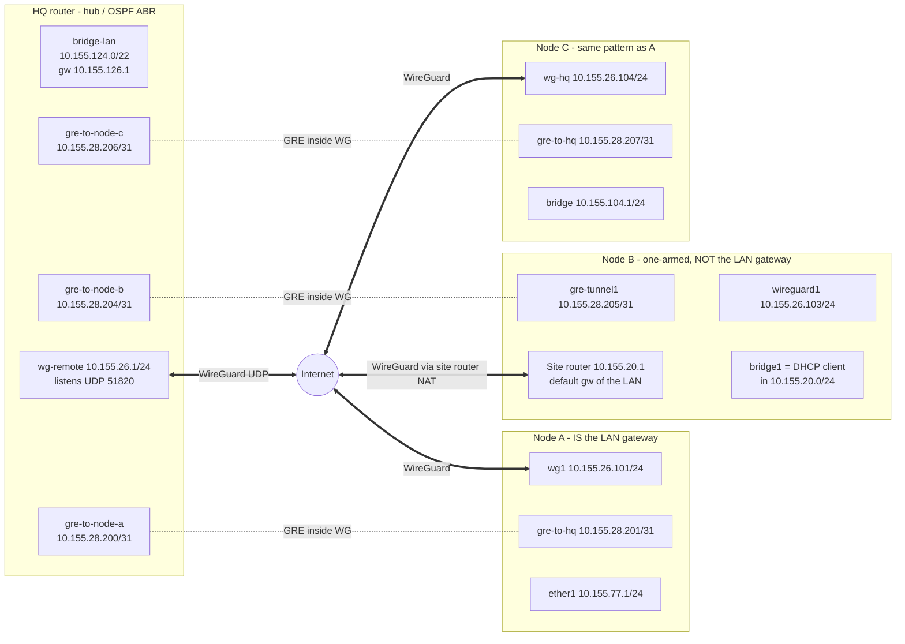

# Multi-site to multi-site VPN — WireGuard + GRE + OSPF on MikroTik RouterOS 7

<p align="center">
  <a href="https://buymeacoffee.com/szorfoktato"></a><br>
  If this guide saved you a few hours, you can support the work at <a href="https://buymeacoffee.com/szorfoktato">buymeacoffee.com/szorfoktato</a> ☕
</p>

---

This guidebook documents a working **hub-and-spoke, routed, multi-site VPN** built from three layers:

1. **WireGuard** – the encrypted transport over the Internet (works through NAT, CGNAT, wireless WANs).
2. **GRE** – one point-to-point tunnel per remote site, carried *inside* WireGuard.
3. **OSPF** – dynamic routing over the GRE tunnels, so every LAN learns every other LAN automatically.

It is reverse-engineered from the real configuration of one HQ router and its remote nodes, and explains not only *what* is configured but *why it works* — including the unusual node that is **not the default gateway of its own LAN, yet everything still works**.

> **Privacy note.** Every address, name, port, key and hostname in this document is **anonymized**.
> All private ranges were moved into `10.155.0.0/16`, the public HQ address is the documentation address `203.0.113.10`, the HQ DNS name is `hq.example.net`, the WireGuard listen port is shown as `51820`. Keys, passwords, SSIDs, MAC addresses, PPPoE credentials and the names of people/companies/customers were removed. Unrelated tunnels that also live on the HQ router (other customers / test setups) are left out.

---

## Table of contents

1. [Topology at a glance](#1-topology-at-a-glance)
2. [Addressing plan](#2-addressing-plan)
3. [Why WireGuard **and** GRE **and** OSPF?](#3-why-wireguard-and-gre-and-ospf)
4. [Layer 1 – WireGuard](#4-layer-1--wireguard)
5. [Allowed addresses explained](#5-allowed-addresses-explained)
6. [Layer 2 – GRE inside WireGuard](#6-layer-2--gre-inside-wireguard)
7. [MTU and MSS](#7-mtu-and-mss)
8. [Layer 3 – OSPF](#8-layer-3--ospf)
9. [Firewall and NAT, device by device](#9-firewall-and-nat-device-by-device)
10. [The node that is *not* the default gateway (Node B)](#10-the-node-that-is-not-the-default-gateway-node-b)
11. [Packet walks – end-to-end examples](#11-packet-walks--end-to-end-examples)
12. [Configuration reference (sanitized)](#12-configuration-reference-sanitized)
13. [Adding a new site – checklist](#13-adding-a-new-site--checklist)
14. [Troubleshooting](#14-troubleshooting)
15. [Review findings and recommended improvements](#15-review-findings-and-recommended-improvements)

---

## 1. Topology at a glance



Plain-text version:

```
                         +----------------------------------------+
                         |              HQ  (hub, OSPF ABR)       |
                         |  LAN 10.155.124.0/22   (area 0.0.0.0)  |
                         |  wg-remote 10.155.26.1/24  UDP 51820   |
                         |   gre-to-node-a  10.155.28.200/31 --+  |
                         |   gre-to-node-b  10.155.28.204/31 --|--+---- (area 0.0.0.101)
                         |   gre-to-node-c  10.155.28.206/31 --+  |
                         +-------------------+--------------------+
                                             | public 203.0.113.10 (PPPoE WAN)
                                     ~~~~~~~~~~~~~~~~~ Internet ~~~~~~~~~~~~~~~~~
                 +---------------------------+-----------------------------+
                 |                           |                             |
     +-----------+-----------+   +-----------+------------+   +------------+-----------+
     | Node A (wireless CPE) |   | Node B (one-armed)     |   | Node C (home router)   |
     | WAN = wlan1 (DHCP)    |   | single bridge1, DHCP   |   | WAN = ether1 (DHCP)    |
     | wg1  10.155.26.101    |   | wireguard1 10.155.26.103|  | wg-hq 10.155.26.104    |
     | gre  10.155.28.201/31 |   | gre  10.155.28.205/31  |   | gre  10.155.28.207/31  |
     | LAN  10.155.77.0/24   |   | LAN  10.155.20.0/24    |   | LAN  10.155.104.0/24   |
     | Node A = LAN gateway  |   | site router = gateway! |   | Node C = LAN gateway   |
     +-----------------------+   +------------------------+   +------------------------+
```

Key facts:

| Item | Value |
|---|---|
| Design | Hub-and-spoke. Spokes always dial the hub; the hub never needs to know the spokes' public IPs. |
| Encryption | WireGuard only (GRE itself is unencrypted, but it never leaves the WireGuard tunnel). |
| Routing | OSPFv2, one GRE point-to-point link per spoke. HQ is the Area Border Router (ABR). |
| Spoke ↔ spoke | Always via the hub (Node A → HQ → Node B). |
| Internet at spokes | Local breakout (each spoke uses its own ISP). |
| Platform | MikroTik RouterOS 7.x (v7 OSPF syntax: `/routing ospf instance / area / interface-template`). |

---

## 2. Addressing plan

All values anonymized, but the *structure* is exactly the real one.

### 2.1 Transport (WireGuard) network – `10.155.26.0/24`

One shared /24 on the hub's WireGuard interface. Every spoke gets **one host address** from it.

| Device | WG interface | WG address | Role |
|---|---|---|---|
| HQ | `wg-remote` | `10.155.26.1/24` | Listens on UDP `51820`, no endpoints configured (responder) |
| Node A | `wg1` | `10.155.26.101/24` | Initiator, endpoint = `hq.example.net:51820` |
| Node B | `wireguard1` | `10.155.26.103/24` | Initiator, endpoint = `hq.example.net:51820` |
| Node C | `wg-hq` | `10.155.26.104/24` | Initiator, endpoint = `hq.example.net:51820` |

(Other host numbers in the same /24 – e.g. `.2`, `.10`, `.11`, `.12`, `.102` – belong to further spokes that follow the identical pattern.)

### 2.2 GRE link networks – `/31` per spoke from `10.155.28.0/24`

| Link | HQ side | Spoke side | GRE outer local → remote (HQ view) |
|---|---|---|---|
| HQ ↔ Node A | `10.155.28.200/31` | `10.155.28.201/31` | `10.155.26.1 → 10.155.26.101` |
| HQ ↔ Node B | `10.155.28.204/31` | `10.155.28.205/31` | `10.155.26.1 → 10.155.26.103` |
| HQ ↔ Node C | `10.155.28.206/31` | `10.155.28.207/31` | `10.155.26.1 → 10.155.26.104` |

Why `/31`? A point-to-point link needs exactly two addresses. A `/31` (RFC 3021) has no network/broadcast address, so it wastes nothing. Convention used here: **HQ always takes the even address, the spoke the odd one.**

> Note: on RouterOS a /31 is entered as `address=10.155.28.200/31 network=10.155.28.200` – i.e. the network equals the even address. You will see that in the HQ export.

### 2.3 LANs

| Site | LAN | Gateway of the LAN | How the router is attached |
|---|---|---|---|
| HQ | `10.155.124.0/22` | HQ (`10.155.126.1`) | HQ is the gateway |
| Node A | `10.155.77.0/24` | Node A (`10.155.77.1`) | Node A is the gateway |
| Node B | `10.155.20.0/24` | **Site router** (`10.155.20.1`) | Node B is just a **DHCP client** inside the LAN |
| Node C | `10.155.104.0/24` | Node C (`10.155.104.1`) | Node C is the gateway |

### 2.4 OSPF identifiers

| Item | Value |
|---|---|
| HQ router-id | `10.155.126.1` (pinned via `/routing id`, taken from the LAN bridge address) |
| Spoke router-ids | automatic (RouterOS picks one of its addresses) |
| Area `backbone` | `0.0.0.0` – HQ LAN only |
| Area `area-remote` | `0.0.0.101` – all GRE links to the spokes + the spokes' LANs |

### 2.5 Why three separate address blocks?

Keeping **transport** (`.26.x`), **link** (`.28.x`) and **user** (LAN) addresses in different blocks is what makes the design easy to reason about:

* the transport block is the only thing WireGuard has to know about;
* the link block is the only thing GRE/OSPF neighbours use;
* LANs can be added/removed without touching WireGuard at all.

---

## 3. Why WireGuard **and** GRE **and** OSPF?

A natural question: "WireGuard is already a tunnel — why put GRE inside it?"

### 3.1 WireGuard alone is a poor fit for dynamic routing on a hub

WireGuard uses **cryptokey routing**: when the hub sends a packet out of `wg-remote`, WireGuard picks the peer **by looking up the packet's destination in the peers' `allowed-address` lists**, *not* by looking at the router's routing table / next-hop.

Consequences on a hub with many peers on one interface:

* Every remote LAN would have to be listed in `allowed-address` of the right peer. Add a LAN at a site → edit WireGuard at both ends.
* OSPF would see **one multi-access interface** with many neighbours, needs multicast (`224.0.0.5/6`) to work across WireGuard, and needs NBMA/PtMP tuning.
* If a route moves (e.g. a backup path), WireGuard would still deliver to whatever peer statically owns the prefix → black holes.

### 3.2 GRE gives every spoke its own clean point-to-point interface

With GRE inside WireGuard:

* WireGuard only ever carries packets **between tunnel endpoints** (`10.155.26.1 ⇄ 10.155.26.10x`). Its `allowed-address` lists stay tiny and **never change** when LANs change.
* Each spoke appears to the hub as a **separate interface** (`gre-to-node-a`, `gre-to-node-b`, …). OSPF treats each as a simple point-to-point link with exactly one neighbour. Multicast hellos just work, because GRE carries them as ordinary payload.
* The routing table — not WireGuard — decides which spoke a packet goes to.
* GRE keepalives give fast link-down detection *and* keep NAT mappings alive (see §6.3).

### 3.3 OSPF removes all static routes

Nobody configured a single static route for remote LANs. Every router advertises its LAN; within ~10–40 s of a tunnel coming up, all sites know all networks. Adding a site = add WG peer + GRE + OSPF template; nothing else anywhere changes (except firewall address lists, see §9).

### 3.4 The layering, end to end

```
 Original packet       [ IP 10.155.124.50 -> 10.155.77.20 | TCP | data ]
 + GRE                 [ IP 10.155.26.1 -> 10.155.26.101 | GRE | (original packet) ]
 + WireGuard           [ IP 203.0.113.10 -> <Node A public> | UDP 51820 | WG | (GRE packet, encrypted) ]
```

---

## 4. Layer 1 – WireGuard

### 4.1 HQ (hub / responder)

* One dedicated interface for all remote sites: `wg-remote`, `listen-port=51820`, `mtu=1420`.
* Address `10.155.26.1/24` on that interface.
* One peer per spoke:
  * `allowed-address = <spoke tunnel IP>/32` (only!)
  * **no `endpoint-address` / `endpoint-port`** – HQ learns the spoke's current public IP:port from the first valid handshake (roaming). This is why spokes can sit behind NAT, CGNAT, mobile or Wi-Fi uplinks with dynamic addresses.
  * `persistent-keepalive=30s` on most peers – once the endpoint is learned, HQ also sends keepalives so the spoke's NAT mapping does not expire even if the spoke is idle.
* The HQ router has *other* WireGuard interfaces for unrelated purposes (road-warriors, other customers). They are deliberately separate interfaces with separate ports so firewall and routing for the site-to-site mesh can be reasoned about independently.

### 4.2 Spokes (initiators)

Each spoke has exactly one WireGuard peer – HQ:

| Setting | Node A | Node B | Node C |
|---|---|---|---|
| `endpoint-address` | `hq.example.net` (DNS name) | `hq.example.net` | `hq.example.net` |
| `endpoint-port` | `51820` | `51820` | `51820` |
| `allowed-address` | `10.155.26.0/24` | `10.155.26.1/32` | `10.155.26.1/32` |
| `persistent-keepalive` | not set | `30s` | not set |
| local `listen-port` | arbitrary (irrelevant, spoke initiates) | default `13231` | arbitrary |

Using a **DNS name** for the endpoint means that if HQ's public IP ever changes, only the DNS record must be updated (RouterOS re-resolves the name).

### 4.3 Who initiates, and why it matters

Only spokes know where the hub is. The hub cannot reach a spoke until that spoke has sent at least one handshake. So the spoke must generate traffic periodically, otherwise its NAT/CGNAT mapping times out and the hub can no longer "call back". On Node B this is `persistent-keepalive=30s`; on Node A and C there is **no WireGuard keepalive**, but it still works because **GRE keepalives (every 10 s) generate traffic through the WireGuard tunnel constantly** (see §6.3). Keepalives configured on the HQ side (`30s`) additionally refresh the mapping from the other direction once the peer is known.

> Recommendation: set `persistent-keepalive=25s` on every spoke anyway. It makes the design independent of the GRE keepalive setting.

---

## 5. Allowed addresses explained

`allowed-address` in WireGuard has **two** meanings at once:

1. **Inbound filter:** a decrypted packet from a peer is accepted only if its *source* IP is inside that peer's `allowed-address`.
2. **Outbound selector:** a packet leaving the WireGuard interface is encrypted to the peer whose `allowed-address` contains the packet's *destination* IP.

RouterOS does **not** create routes from `allowed-address` (unlike `wg-quick` on Linux). Routing is done by the connected route of the WG address (`10.155.26.0/24`) and by OSPF.

### 5.1 What actually travels through WireGuard here

Only **GRE packets** and nothing else:

* source `10.155.26.10x` → destination `10.155.26.1` (spoke → hub)
* source `10.155.26.1` → destination `10.155.26.10x` (hub → spoke)

User traffic (LAN to LAN) is hidden *inside* the GRE payload, so WireGuard never sees LAN addresses. Therefore:

| Where | allowed-address | Why it is enough |
|---|---|---|
| HQ, peer *Node A* | `10.155.26.101/32` | Only Node A's tunnel IP ever appears as source from that peer, and HQ only needs to send `→10.155.26.101` to it. |
| HQ, peer *Node B* | `10.155.26.103/32` | Same logic. |
| HQ, peer *Node C* | `10.155.26.104/32` | Same logic. |
| Node B / Node C, peer *HQ* | `10.155.26.1/32` | The spoke only talks to HQ's tunnel IP. Strictest possible setting. |
| Node A, peer *HQ* | `10.155.26.0/24` | Also works; slightly broader – it would let Node A send/receive any `10.155.26.x` via HQ. Harmless here, but `/32` is cleaner. |

### 5.2 The big benefit

**Adding, renumbering or removing a LAN never requires touching WireGuard.** You change OSPF (usually nothing – the new connected network is advertised automatically if the interface is in a template) and the firewall address lists.

### 5.3 Rules to remember

* On the **hub**, allowed-address entries of different peers on the same interface must **never overlap** – overlap means WireGuard can't decide which peer gets a packet. Hence `/32` per spoke.
* Never put a remote **LAN** into allowed-address in this design – it would bypass GRE/OSPF for that prefix and silently break routing when paths change.
* Fields like *client-address*, *client-endpoint*, *client-dns* and the QR code that RouterOS 7.15+ shows on peers are only used to **generate a configuration file for a client device**; they do not affect the tunnel.

---

## 6. Layer 2 – GRE inside WireGuard

### 6.1 Tunnel definitions

| Interface | Device | local-address | remote-address | keepalive |
|---|---|---|---|---|
| `gre-to-node-a` | HQ | `10.155.26.1` | `10.155.26.101` | `10s,10` |
| `gre-to-node-b` | HQ | `10.155.26.1` | `10.155.26.103` | `10s,10` |
| `gre-to-node-c` | HQ | `10.155.26.1` | `10.155.26.104` | `10s,10` |
| `gre-to-hq` | Node A | `10.155.26.101` | `10.155.26.1` | `10s,10` |
| `gre-tunnel1` | Node B | `10.155.26.103` | `10.155.26.1` | `10s,10` |
| `gre-to-hq` | Node C | `10.155.26.104` | `10.155.26.1` | `10s,10` |

Other GRE settings are RouterOS defaults: `mtu=auto`, `clamp-tcp-mss=yes`, `allow-fast-path=yes`, no `ipsec-secret` (encryption is already provided by WireGuard – adding IPsec would double-encrypt).

### 6.2 Why the outer addresses are the **WireGuard** addresses

The GRE tunnel's `local-address`/`remote-address` are the WireGuard tunnel IPs, **not** public IPs. So:

* the route to the GRE remote (`10.155.26.1` from a spoke) is the **connected** route of the WG interface → GRE packets are always sent into WireGuard;
* GRE never touches the Internet in clear text;
* public IP changes, NAT and CGNAT are irrelevant to GRE.

> **Recursive-routing trap avoided:** the GRE endpoint (`10.155.26.0/24`) must *never* become reachable through the GRE tunnel itself. Here it is a **connected** network on the WG interface (distance 0), so even if OSPF learned `10.155.26.0/24` from somewhere, the connected route wins. Do not move the WG addresses into OSPF-only reachability.

### 6.3 GRE keepalive – two jobs

`keepalive=10s,10` = send a keepalive every 10 s; declare the tunnel down after 10 missed replies (~100 s).

1. **Link state:** when the WG tunnel dies, GRE goes *down*, the OSPF interface goes down immediately, and routes are withdrawn instead of waiting for the OSPF dead timer.
2. **NAT keepalive (side effect):** a GRE keepalive is a real packet that WireGuard must encrypt and send → there is traffic every 10 s through each spoke's NAT, so the mapping never expires. This is why Node A and Node C work fine without WireGuard `persistent-keepalive`.

---

## 7. MTU and MSS

Overhead stack (IPv4):

| Layer | Bytes | Resulting MTU |
|---|---|---|
| Physical / WAN Ethernet | – | 1500 (HQ's PPPoE WAN: 1492) |
| WireGuard (outer IPv4 20 + UDP 8 + WG 32) | 60 | **1420** – WG interface MTU on all devices (1440 would fit 1500, 1420 also leaves room for IPv6 outer / PPPoE) |
| GRE (outer IPv4 20 + GRE 4) | 24 | **1396** – actual MTU of every GRE interface (`mtu=auto`) |
| TCP MSS inside GRE (− IP 20 − TCP 20) | 40 | **1356** – maximum safe TCP MSS through the mesh |

* Check: 1396 + 24 + 60 = 1480 ≤ 1492 (PPPoE) ✔
* `clamp-tcp-mss=yes` on the GRE interfaces (default) automatically rewrites the MSS of TCP SYNs that go through the tunnel to 1356 — this is what keeps HTTPS/SMB from stalling on large packets.
* Node C additionally has a mangle `change-mss` rule for the GRE interface with `new-mss=1368`. That value is 12 bytes **too high** for GRE-over-WG (1368 + 40 = 1408 > 1396). It does no harm only because the GRE interface's own clamp lowers it to 1356 anyway. If you keep a manual rule, use `new-mss=1356` (or `clamp-to-pmtu`).
* Fasttracked connections skip mangle rules but are still clamped by the GRE interface option, so the interface-level clamp is the reliable one.

---

## 8. Layer 3 – OSPF

### 8.1 Area design

```
                 Area 0.0.0.0 (backbone)                   Area 0.0.0.101 (area-remote)
      +-----------------------------------+      +----------------------------------------------+
      |  HQ LAN 10.155.124.0/22           |      |  gre HQ<->A   10.155.28.200/31   LAN A /24    |
      |  (interface-template: LAN list)   |<---->|  gre HQ<->B   10.155.28.204/31   LAN B /24    |
      |                                   |  HQ  |  gre HQ<->C   10.155.28.206/31   LAN C /24    |
      +-----------------------------------+ (ABR)+----------------------------------------------+
```

* **HQ** runs one OSPF instance with two areas → it is the **ABR**.
  * `backbone` (`0.0.0.0`): interface-template = interface list **LAN** (HQ's LAN bridge). Type broadcast.
  * `area-remote` (`0.0.0.101`): one interface-template per spoke GRE interface. Type **ptp**.
  * HQ pins its router-id with `/routing id` (`10.155.126.1`, from the LAN bridge) so it never changes when tunnel interfaces flap.
  * HQ's instance also has route redistribution enabled (it appears to be `redistribute=connected`). Those routes reach the spokes as external (type-5) routes.
* **Each spoke** runs OSPF only in `area-remote` (`0.0.0.101`). A router that lives only in a non-backbone area is a normal *internal router*; it receives:
  * **intra-area** routes: the other spokes' LANs and GRE /31s (all in the same area);
  * **inter-area (type-3 summary)** routes from the ABR: HQ's LAN `10.155.124.0/22`;
  * **external** routes if HQ redistributes anything.

The area-id **must be identical** on both ends of every GRE link (`0.0.0.101`), otherwise the adjacency never comes up.

### 8.2 Interface templates on each device

| Device | Template (interfaces) | Area | Type | Cost | Priority | What it achieves |
|---|---|---|---|---|---|---|
| HQ | interface-list `LAN` | backbone | broadcast | 1 | 128 | advertises `10.155.124.0/22` |
| HQ | `gre-to-node-a` | area-remote | ptp | 1 | 128 | adjacency with Node A |
| HQ | `gre-to-node-b` | area-remote | ptp | 1 | 128 | adjacency with Node B |
| HQ | `gre-to-node-c` | area-remote | ptp | 1 | 128 | adjacency with Node C |
| Node A | `gre-to-hq` | area-remote | (see §15) | 1 | 128 | adjacency with HQ |
| Node A | `ether1` (LAN) | area-remote | broadcast | 1 | 128 | advertises `10.155.77.0/24` |
| Node B | `gre-tunnel1` | area-remote | ptp | 1 | 128 | adjacency with HQ |
| Node B | `bridge1` (LAN) | area-remote | broadcast | 1 | **0** | advertises `10.155.20.0/24`; priority 0 = never DR on a LAN it does not own |
| Node C | interface-list `LAN` | area-remote | broadcast | 1 | 128 | advertises `10.155.104.0/24` |
| Node C | `gre-to-hq` | area-remote | ptp | 1 | 128 | adjacency with HQ |

Timers everywhere: hello `10s`, dead `40s`, retransmit `5s`, transmit-delay `1s` (defaults – must match on both ends).

**How LANs get advertised:** In RouterOS 7, putting an interface into an interface-template makes OSPF advertise **every network configured on that interface**. That's why no `network` statements or redistribution are needed on the spokes – the LAN interface's own connected subnet is announced. For Node B this even works with a DHCP-learned address: whatever `/24` the DHCP client gets on `bridge1` is announced.

**Why `type=ptp` on GRE:** on a point-to-point link there is no DR/BDR election, adjacency forms faster, and the LSA describes a real p2p link. Both ends must use the same type.

### 8.3 Resulting routing tables (simplified)

HQ:

```
DAo 10.155.77.0/24    via gre-to-node-a   (intra-area, area-remote)
DAo 10.155.20.0/24    via gre-to-node-b   (intra-area, area-remote)
DAo 10.155.104.0/24   via gre-to-node-c   (intra-area, area-remote)
DAc 10.155.26.0/24    wg-remote           (connected – carries GRE)
DAc 10.155.124.0/22   bridge-lan          (connected)
DAs 0.0.0.0/0         pppoe-out1          (ISP)
```

Node A (Node B and C look the same, with their own LAN connected):

```
DAo 10.155.124.0/22   via gre-to-hq       (inter-area, from ABR)
DAo 10.155.20.0/24    via gre-to-hq       (intra-area – Node B's LAN, through HQ)
DAo 10.155.104.0/24   via gre-to-hq       (intra-area – Node C's LAN, through HQ)
DAc 10.155.26.0/24    wg1                 (connected – GRE endpoint reachability)
DAc 10.155.77.0/24    ether1              (connected)
DAd 0.0.0.0/0         via <ISP gw> wlan1  (DHCP client – local Internet breakout)
```

The default route at every spoke is the local ISP (DHCP, distance 1), so OSPF never pulls Internet traffic to HQ unless you deliberately do policy routing (Node C does that for some destinations – out of scope here).

---

## 9. Firewall and NAT, device by device

Firewall is where most multi-site VPNs silently break. Below is what each device needs and what it actually has.

### 9.1 What the VPN needs to pass

| Traffic | Where it must be accepted | Chain |
|---|---|---|
| WireGuard UDP from the Internet to the HQ listen port | HQ | `input` (from WAN) |
| WireGuard replies at the spokes | spokes | `input` – covered by `established,related` because the spoke initiated |
| GRE (IP protocol 47) arriving from the WG interface | all | `input` |
| OSPF (IP protocol 89) arriving on GRE interfaces | all | `input` |
| LAN ↔ LAN traffic routed through GRE | all | `forward` |
| No NAT between sites (real source IPs) | all | `srcnat` must only masquerade toward WAN |

### 9.2 HQ firewall (relevant rules, in order, translated comments)

**`input` chain** ("Pos." = position in the real ruleset, counted from 0; rules for unrelated tunnels/tenants are omitted)

| Pos. | Rule | Purpose for the VPN |
|---|---|---|
| 0 | `add-src-to-address-list` for new TCP from WAN (port-scan detection → `IP_drop` list, used by a raw `prerouting` drop) | protection; not VPN-specific |
| 2 | `accept protocol=udp dst-port=51820,…` – "WireGuard" | **lets spokes reach the hub** |
| 3–8 | other WireGuard/remote-access ports and interfaces | unrelated tunnels |
| 9 | `accept protocol=icmp` | ping to router (e.g. tunnel tests) |
| 10–11 | `accept connection-state=established` / `related` | return traffic |
| 12–16 | PPTP/L2TP/IPsec ports, `accept protocol=gre` | legacy remote-access VPNs. **Note:** the GRE accept has no interface restriction – see §15 |
| 23 | `accept src-address-list="remote networks"` – "remote networks may administer the router" | intended for spoke admin access – **dead rule**, list name does not exist (see §15) |
| 24 | `accept src-address-list=HQ-LAN ipsec-policy=in,ipsec` | unrelated |
| 25 | `drop in-interface-list=WAN` – "what we didn't allow, we block" | **default deny – but only for WAN** |

Important consequence of rule 25: the drop applies only to interfaces in list **WAN** (= the PPPoE uplink). `wg-remote` and all `gre-to-*` interfaces are **not in WAN**, so **GRE packets arriving through WireGuard and OSPF packets arriving through GRE are implicitly accepted** – no explicit OSPF rule is needed. The same goes for Winbox/SSH from the spokes to the HQ router.

**`forward` chain**

| Pos. | Rule | Effect |
|---|---|---|
| 26 | `drop connection-state=invalid in-interface-list=WAN` | hygiene |
| 27 | port-scan detection for new TCP from WAN | protection |
| 28 | `fasttrack-connection connection-state=established,related` | performance (also for tunnelled flows) |
| 29 | `accept src-address-list=HQ-LAN out-interface-list=WAN` | HQ LAN → Internet |
| 31–32 | `accept ipsec-policy=in/out,ipsec` | keep IPsec out of fasttrack |
| 33 | `accept connection-state=established,related` | return traffic not fasttracked |
| 43 | `accept src-address-list=NET-REMOTE dst-address-list=HQ-LAN` | **spoke LANs → HQ LAN** |
| 44 | `accept src-address-list=HQ-LAN dst-address-list=NET-REMOTE` | **HQ LAN → spoke LANs** |
| 46 | `accept src-address-list=NET-REMOTE dst-address-list=NET-REMOTE` | **spoke ↔ spoke through the hub** |
| 47 | `accept src-address-list=NET-REMOTE out-interface-list=WAN` | spokes may use HQ's Internet (only used when a spoke policy-routes traffic to HQ) |
| … | rules for other tenants | unrelated |
| 68 | `drop` – "Drop forward" | **default deny for everything else** |

Address list **`NET-REMOTE`** (real name differs) – the heart of the VPN policy:

```
/ip firewall address-list
add list=NET-REMOTE address=10.155.77.0/24   comment="Node A LAN"
add list=NET-REMOTE address=10.155.20.0/24   comment="Node B LAN"
add list=NET-REMOTE address=10.155.104.0/24  comment="Node C LAN"
add list=NET-REMOTE address=10.155.26.104    comment="Node C tunnel IP"
add list=NET-REMOTE address=10.155.123.0/24  comment="another spoke LAN"
add list=HQ-LAN     address=10.155.124.0/22
```

> Because the HQ `forward` chain ends in **drop**, a brand-new spoke works at the routing level (OSPF up, routes present) but **its traffic is dropped until its LAN is added to `NET-REMOTE`**. This is the #1 thing to remember when adding a site.

**NAT on HQ**

```
/ip firewall nat
add chain=srcnat action=masquerade out-interface-list=WAN        comment="outgoing Internet"
add chain=srcnat action=masquerade src-address=10.155.124.0/22 dst-address=10.155.124.0/22 comment="hairpin NAT"
add chain=srcnat action=masquerade src-address=10.155.26.104     comment="Node C tunnel IP (Node C-specific)"
# + dst-nat port forwards for local servers (unrelated)
```

There is **no NAT between HQ LAN and the spoke LANs** – packets keep their real source address, so logs and per-host firewall rules on both sides see the true client IP. The masquerade only matches `out-interface-list=WAN`, which never includes GRE. (The Node C rule masquerades traffic *sourced from Node C's tunnel IP*, which Node C uses for some policy-routed flows; it is specific to that node.)

### 9.3 Node A firewall (RouterOS default config + VPN additions)

Interface lists – **this is what makes Node A's defconf firewall VPN-friendly:**

| List | Members |
|---|---|
| WAN | `wlan1` (wireless uplink, DHCP client) |
| LAN | `ether1`, **`wg1`**, **`gre-to-hq`** |

```
/ip firewall filter
add chain=input   action=accept connection-state=established,related,untracked
add chain=input   action=accept protocol=udp dst-port=500,4500,1701   comment="Allow L2TP/IPsec VPN"
add chain=input   action=accept protocol=ipsec-esp                    comment="Allow IPsec ESP"
add chain=input   action=drop   connection-state=invalid
add chain=input   action=accept protocol=icmp
add chain=input   action=accept dst-address=127.0.0.1
add chain=input   action=drop   in-interface-list=!LAN                comment="drop all not coming from LAN"
add chain=forward action=accept ipsec-policy=in,ipsec
add chain=forward action=accept ipsec-policy=out,ipsec
add chain=forward action=fasttrack-connection connection-state=established,related
add chain=forward action=accept connection-state=established,related,untracked
add chain=forward action=drop   connection-state=invalid
add chain=forward action=drop   connection-state=new connection-nat-state=!dstnat in-interface-list=WAN
/ip firewall nat
add chain=srcnat action=masquerade out-interface-list=WAN ipsec-policy=out,none
```

Why this works:

* **WireGuard:** Node A initiates, so HQ's UDP replies on `wlan1` are `established` → accepted by the first rule. No inbound port needs to be opened.
* **GRE** arrives on `wg1`, **OSPF** arrives on `gre-to-hq` – both interfaces are in **LAN**, so `drop … in-interface-list=!LAN` does not hit them.
* **Forward:** the defconf forward chain only drops *new connections from WAN*. Traffic from `gre-to-hq` (LAN list) to `ether1` and back is allowed.
* **NAT:** masquerade only toward WAN (`wlan1`) → inter-site traffic keeps real IPs.

> Note the trade-off: putting the tunnel interfaces into **LAN** means "trust the other sites like the local LAN" – including management access to Node A from any site. HQ's forward policy is the real gatekeeper.

### 9.4 Node B firewall

```
/ip firewall filter
# (empty – no filter rules at all)
/ip firewall nat
add chain=srcnat action=masquerade src-address=10.155.89.0/24 disabled=yes comment="masq. vpn traffic (old, unused)"
add chain=srcnat action=masquerade dst-address=10.155.20.0/24 out-interface=bridge1
```

* No filter rules: everything is accepted. Node B is behind the site router's NAT, so from the Internet only the WireGuard flow it initiated can reach it. Still, see §15 for a minimal ruleset.
* The **one NAT rule that matters** is the second one – it is the whole trick behind the "not the default gateway" setup. It is explained in detail in the next section.

### 9.5 Node C firewall (short)

Default configuration (input drop from WAN is **disabled** on this device – see §15), fasttrack disabled, MSS clamp mangle rules, masquerade only toward WAN and two other WireGuard uplinks. The tunnel to HQ is not masqueraded, so real IPs are preserved.

---

## 10. The node that is *not* the default gateway (Node B)

This is the most interesting part of the network.

### 10.1 The situation

At site B there is already a router (the ISP/site router, `10.155.20.1`) that is the **DHCP server and default gateway** for every device in `10.155.20.0/24`. Nobody wanted to replace it or change its settings.

Node B is plugged into that LAN like any PC:

* Its ports (`ether1`, `ether2`, `ether3` and Wi-Fi) are all in **one bridge** – `bridge1`.
* `bridge1` runs a **DHCP client**: Node B gets e.g. `10.155.20.250/24` *and* its default route `0.0.0.0/0 via 10.155.20.1` from the site router.
* There is **no "WAN" port in the usual sense**. Node B reaches the Internet (and HQ) *through the site router*, which NATs its WireGuard packets.

This is called a **one-armed** (or "router-on-a-stick") VPN gateway.

```
            Site B LAN 10.155.20.0/24
   +------------------+-------------------+------------------------+
   |                  |                   |                        |
 PC 10.155.20.30   Printer          Node B (DHCP: 10.155.20.250)   Site router 10.155.20.1
 gw = .1           gw = .1          wireguard1 + gre-tunnel1       DHCP server + default gw
                                    (VPN only)                     NAT to Internet
```

### 10.2 The problem a one-armed router normally has

Take an HQ PC `10.155.124.50` opening a connection to the site-B PC `10.155.20.30`:

1. HQ routes it into `gre-to-node-b` (OSPF route). Node B decapsulates and sends it out of `bridge1` to `10.155.20.30`. ✔
2. The PC wants to reply to `10.155.124.50`. That is **not** in its own subnet, so it sends the reply to its **default gateway – the site router**, not to Node B. ✘
3. The site router has no route to `10.155.124.0/22`; it sends the reply to the Internet (where it dies) or drops it.

Result: asymmetric routing, connections never establish. Classic fixes would be: make Node B the default gateway, add static routes on every PC, or add a static route on the site router (often impossible on ISP-managed boxes).

### 10.3 The fix used here: source-NAT toward the LAN

```
/ip firewall nat
add chain=srcnat action=masquerade dst-address=10.155.20.0/24 out-interface=bridge1
```

Read it as: *"Anything that I route **into** my LAN gets my own LAN IP as source."*

Same flow with the rule:

1. Packet arrives from GRE: `10.155.124.50 → 10.155.20.30`.
2. Node B routes it out of `bridge1`; srcnat masquerade rewrites the source: `10.155.20.250 → 10.155.20.30`. Conntrack remembers the mapping.
3. The PC sees a request **from a neighbour in its own subnet** → replies directly to `10.155.20.250` via ARP. The site router is not involved. ✔
4. Node B's conntrack un-NATs the reply back to `10.155.20.30 → 10.155.124.50` and routes it into `gre-tunnel1`. ✔

Why the rule does **not** break anything else:

* `dst-address=10.155.20.0/24` + `out-interface=bridge1` matches only packets **routed** into the LAN. Ordinary LAN traffic between PCs is **bridged** (layer 2) and never passes srcnat.
* Node B's own WireGuard packets leave toward the Internet (destination = HQ public IP), not toward `10.155.20.0/24`, so they are not affected.
* `masquerade` (not `src-nat to-addresses=…`) automatically follows the DHCP address if it changes.

### 10.4 How routes still find Node B

* Node B's OSPF template includes `bridge1`, so OSPF advertises **`10.155.20.0/24`** – the subnet of whatever address DHCP handed out. HQ and the other spokes therefore route `10.155.20.0/24` into the tunnel toward Node B.
* `priority=0` on that template guarantees Node B never tries to become DR on a LAN segment it does not own.
* Node B itself needs nothing but the **connected** LAN route + **DHCP default route** (for WireGuard to reach HQ) + **OSPF routes** for the remote LANs.

### 10.5 Consequences and limitations – know these!

| Topic | Effect |
|---|---|
| Direction | Works perfectly for connections **initiated from the other sites toward site B** (management, monitoring, file access to devices at site B). |
| Initiating *from* site B | A site-B PC that opens a connection to `10.155.124.x` still sends it to its default gateway (site router) → **fails**, unless that PC (or the site router) has a route `10.155.0.0/16 via 10.155.20.250`. Options: static route on the PC, DHCP option 121 (classless static route) on the site router, or a static route on the site router. |
| Source visibility | Devices at site B see **all** VPN traffic as coming from `10.155.20.250`. Per-source ACLs/logs on those devices lose the real client IP. |
| DHCP address | If you add routes on PCs, give Node B a **DHCP reservation** on the site router, otherwise the route breaks when the lease changes. Masquerade itself copes with changes. |
| Single segment | WireGuard packets leave and enter via the same `bridge1` as LAN traffic – fine for the bandwidth involved, and it means no second cable/port is needed. |
| Old rule | The disabled masquerade for `10.155.89.0/24` is a leftover from an earlier addressing and can be deleted. |

---

## 11. Packet walks – end-to-end examples

### 11.1 HQ PC → Node A device (`10.155.124.50 → 10.155.77.20`)

1. PC → default gw HQ `10.155.126.1`.
2. HQ forward chain: rule 44 (`HQ-LAN → NET-REMOTE`) **accept**.
3. HQ route `10.155.77.0/24 via gre-to-node-a` (OSPF intra-area).
4. GRE encapsulates: outer `10.155.26.1 → 10.155.26.101`.
5. Route to `10.155.26.101` = connected on `wg-remote`; WireGuard selects peer by allowed-address `10.155.26.101/32`, encrypts, sends to Node A's last-seen public `IP:port`.
6. HQ srcnat: out-interface is GRE, not WAN → **no masquerade**.
7. Node A: UDP reply-flow is established → input accept; WG decrypts (source `10.155.26.1` ⊂ allowed `10.155.26.0/24` ✔); GRE input on `wg1` (LAN list ✔); decapsulated packet appears on `gre-to-hq`.
8. Node A forward: from `gre-to-hq` (LAN) – not dropped. Delivered to `10.155.77.20` with real source `10.155.124.50`.
9. Reply: device's gateway is Node A → route `10.155.124.0/22 via gre-to-hq` (inter-area) → symmetric return.

### 11.2 Node A device → Node B device (`10.155.77.20 → 10.155.20.30`)

1. Node A routes via `gre-to-hq` (spoke-to-spoke always transits the hub).
2. HQ receives on `gre-to-node-a`, forward rule 46 (`NET-REMOTE → NET-REMOTE`) **accept**, routes out `gre-to-node-b`.
3. Node B decapsulates, routes to `bridge1`, **masquerades** to `10.155.20.250` (see §10).
4. Reply returns the same way. Total: 2 GRE hops, 2 WireGuard hops, encrypted end to end on each leg.

### 11.3 New site added but forgot the address list

OSPF neighbour **Full**, routes present on all routers, ping from the new site's router to HQ's router works – but LAN-to-LAN traffic is dropped by HQ forward rule 68. Fix: add the new LAN to `NET-REMOTE`.

---

## 12. Configuration reference (sanitized)

Only the VPN-relevant parts, in RouterOS 7 export syntax. Keys are placeholders.

### 12.1 HQ

```
# --- WireGuard (transport) ---
/interface wireguard
add name=wg-remote listen-port=51820 mtu=1420 private-key="<HQ-PRIVATE-KEY>"
/interface wireguard peers
add interface=wg-remote name=peer-node-a public-key="<NODE-A-PUBKEY>" allowed-address=10.155.26.101/32 persistent-keepalive=30s
add interface=wg-remote name=peer-node-b public-key="<NODE-B-PUBKEY>" allowed-address=10.155.26.103/32 persistent-keepalive=30s
add interface=wg-remote name=peer-node-c public-key="<NODE-C-PUBKEY>" allowed-address=10.155.26.104/32
/ip address
add interface=wg-remote address=10.155.26.1/24 comment="WG remote networks"

# --- GRE (one per spoke, inside WG) ---
/interface gre
add name=gre-to-node-a local-address=10.155.26.1 remote-address=10.155.26.101 keepalive=10s,10
add name=gre-to-node-b local-address=10.155.26.1 remote-address=10.155.26.103 keepalive=10s,10
add name=gre-to-node-c local-address=10.155.26.1 remote-address=10.155.26.104 keepalive=10s,10
/ip address
add interface=gre-to-node-a address=10.155.28.200/31 network=10.155.28.200 comment=GRE
add interface=gre-to-node-b address=10.155.28.204/31 network=10.155.28.204 comment=GRE
add interface=gre-to-node-c address=10.155.28.206/31 network=10.155.28.206 comment=GRE

# --- OSPF ---
/routing id
add name=id-bridge id=10.155.126.1
/routing ospf instance
add name=ospf-hq version=2 router-id=id-bridge redistribute=connected
/routing ospf area
add name=backbone    instance=ospf-hq area-id=0.0.0.0
add name=area-remote instance=ospf-hq area-id=0.0.0.101 comment="remote sites"
/routing ospf interface-template
add area=backbone    interfaces=LAN           type=broadcast
add area=area-remote interfaces=gre-to-node-a type=ptp
add area=area-remote interfaces=gre-to-node-b type=ptp
add area=area-remote interfaces=gre-to-node-c type=ptp

# --- Firewall (VPN-relevant excerpt) ---
/ip firewall address-list
add list=HQ-LAN     address=10.155.124.0/22
add list=NET-REMOTE address=10.155.77.0/24  comment="Node A"
add list=NET-REMOTE address=10.155.20.0/24  comment="Node B"
add list=NET-REMOTE address=10.155.104.0/24 comment="Node C"
/ip firewall filter
add chain=input   action=accept protocol=udp dst-port=51820 comment="WireGuard"
add chain=input   action=accept connection-state=established,related
add chain=input   action=drop   in-interface-list=WAN
add chain=forward action=fasttrack-connection connection-state=established,related
add chain=forward action=accept connection-state=established,related
add chain=forward action=accept src-address-list=HQ-LAN     out-interface-list=WAN
add chain=forward action=accept src-address-list=NET-REMOTE dst-address-list=HQ-LAN
add chain=forward action=accept src-address-list=HQ-LAN     dst-address-list=NET-REMOTE
add chain=forward action=accept src-address-list=NET-REMOTE dst-address-list=NET-REMOTE
add chain=forward action=accept src-address-list=NET-REMOTE out-interface-list=WAN
add chain=forward action=drop
/ip firewall nat
add chain=srcnat action=masquerade out-interface-list=WAN
```

### 12.2 Node A (gateway of its LAN, wireless WAN)

```
/interface wireguard
add name=wg1 mtu=1420 private-key="<NODE-A-PRIVATE-KEY>"
/interface wireguard peers
add interface=wg1 name=hq public-key="<HQ-PUBKEY>" endpoint-address=hq.example.net endpoint-port=51820 allowed-address=10.155.26.0/24
/interface gre
add name=gre-to-hq local-address=10.155.26.101 remote-address=10.155.26.1 keepalive=10s,10
/ip address
add interface=ether1    address=10.155.77.1/24
add interface=wg1       address=10.155.26.101/24
add interface=gre-to-hq address=10.155.28.201/31 network=10.155.28.200
/ip dhcp-client
add interface=wlan1
/interface list member
add list=WAN interface=wlan1
add list=LAN interface=ether1
add list=LAN interface=wg1
add list=LAN interface=gre-to-hq
/routing ospf instance
add name=ospf-instance-1 version=2
/routing ospf area
add name=area-remote instance=ospf-instance-1 area-id=0.0.0.101
/routing ospf interface-template
add area=area-remote interfaces=gre-to-hq type=ptp
add area=area-remote interfaces=ether1
# firewall: RouterOS defconf (see 9.3)
```

### 12.3 Node B (one-armed, NOT the LAN gateway)

```
/interface bridge
add name=bridge1
/interface bridge port
add bridge=bridge1 interface=ether1
add bridge=bridge1 interface=ether2
add bridge=bridge1 interface=ether3
add bridge=bridge1 interface=wlan1
/ip dhcp-client
add interface=bridge1                      # gets 10.155.20.x + default route from the site router
/interface wireguard
add name=wireguard1 mtu=1420 private-key="<NODE-B-PRIVATE-KEY>"
/interface wireguard peers
add interface=wireguard1 name=hq public-key="<HQ-PUBKEY>" endpoint-address=hq.example.net endpoint-port=51820 allowed-address=10.155.26.1/32 persistent-keepalive=30s
/interface gre
add name=gre-tunnel1 local-address=10.155.26.103 remote-address=10.155.26.1 keepalive=10s,10
/ip address
add interface=wireguard1  address=10.155.26.103/24
add interface=gre-tunnel1 address=10.155.28.205/31 network=10.155.28.204
/routing ospf instance
add name=ospf-instance-1 version=2
/routing ospf area
add name=area-remote instance=ospf-instance-1 area-id=0.0.0.101
/routing ospf interface-template
add area=area-remote interfaces=bridge1     priority=0
add area=area-remote interfaces=gre-tunnel1 type=ptp
/ip firewall nat
add chain=srcnat action=masquerade dst-address=10.155.20.0/24 out-interface=bridge1 comment="one-armed: VPN traffic into LAN gets my LAN IP"
```

---

## 13. Adding a new site – checklist

Example: new Node D, LAN `10.155.105.0/24`, tunnel IP `10.155.26.105`, GRE link `10.155.28.208/31`.

**On Node D**

1. `/interface wireguard add name=wg-hq mtu=1420` → note its public key.
2. Peer HQ: `endpoint-address=hq.example.net endpoint-port=51820 allowed-address=10.155.26.1/32 persistent-keepalive=25s`.
3. `/ip address add interface=wg-hq address=10.155.26.105/24`.
4. `/interface gre add name=gre-to-hq local-address=10.155.26.105 remote-address=10.155.26.1 keepalive=10s,10`.
5. `/ip address add interface=gre-to-hq address=10.155.28.209/31 network=10.155.28.208`.
6. OSPF instance + area `0.0.0.101` + templates (`gre-to-hq` type=ptp, LAN interface – preferably `passive`).
7. Firewall: put `wg-hq` + `gre-to-hq` into the LAN list (defconf), or explicitly accept GRE/OSPF on input and tunnel traffic on forward.
8. If Node D is **not** the LAN gateway: add the one-armed masquerade rule from §10.3.

**On HQ**

9. Peer: `interface=wg-remote public-key=<Node D> allowed-address=10.155.26.105/32 persistent-keepalive=30s`.
10. `/interface gre add name=gre-to-node-d local-address=10.155.26.1 remote-address=10.155.26.105 keepalive=10s,10`.
11. `/ip address add interface=gre-to-node-d address=10.155.28.208/31 network=10.155.28.208`.
12. `/routing ospf interface-template add area=area-remote interfaces=gre-to-node-d type=ptp`.
13. **`/ip firewall address-list add list=NET-REMOTE address=10.155.105.0/24`** ← don't forget!

Nothing has to change on the existing spokes – they learn Node D's LAN via OSPF automatically.

---

## 14. Troubleshooting

Work bottom-up: WireGuard → GRE → OSPF → firewall.

| Step | Command | Healthy result |
|---|---|---|
| WG handshake | `/interface wireguard peers print detail` | `last-handshake` < 2 min, rx/tx counters growing, HQ shows a `current-endpoint-address` |
| WG reachability | `/ping 10.155.26.1 src-address=10.155.26.103` (from spoke) | replies |
| GRE state | `/interface gre print` | `R` (running) flag; if not running, keepalives fail → WG problem |
| GRE reachability | `/ping 10.155.28.204` (from Node B) | replies |
| OSPF neighbour | `/routing ospf neighbor print` | state `Full` on each GRE interface |
| OSPF routes | `/ip route print where ospf` | all remote LANs present |
| LSAs | `/routing ospf lsa print` | router LSA of each spoke in area `0.0.0.101` |
| Firewall | `/ip firewall filter print stats` | counters on the `NET-REMOTE` accept rules grow; the final drop does not grow for tunnel traffic |
| Conntrack | `/ip firewall connection print where dst-address~"10.155.20."` | entries with `srcnat` flag on Node B for one-armed traffic |
| Packet capture | `/tool sniffer quick interface=gre-tunnel1` | traffic in both directions |

Typical faults:

* **Handshake OK, GRE down:** wrong `local-address/remote-address`, or the WG `allowed-address` does not contain the GRE peer's tunnel IP.
* **GRE up, OSPF stuck in `Init`/`ExStart`:** area-id, type (ptp vs broadcast), hello/dead timer mismatch, or MTU mismatch (OSPF DBD exchange). Also check the input chain does not drop protocol 89 on the GRE interface.
* **Routes OK, no traffic:** HQ `NET-REMOTE` list missing the LAN; or on a one-armed node the srcnat rule is missing.
* **Small pings OK, web pages hang:** MTU/MSS – make sure `clamp-tcp-mss=yes` on GRE and MSS ≤ 1356.
* **Spoke reachable only after it sends something:** no keepalive on the spoke and GRE keepalive disabled → NAT mapping expired.

---

## 15. Review findings and recommended improvements

Things noticed while documenting the real configs. None of them break the VPN today, but they are worth fixing.

| # | Device | Finding | Recommendation |
|---|---|---|---|
| 1 | HQ | The input rule "remote networks may administer the router" uses `src-address-list="remote networks"`, but the list actually defined is named differently (here: `NET-REMOTE`). The rule never matches. Spokes can still manage HQ only because the final input drop is limited to WAN. | Change it to `src-address-list=NET-REMOTE`, or delete it. |
| 2 | HQ | `accept protocol=gre` on input has no source/interface restriction – GRE from the whole Internet reaches the router. | Restrict to `in-interface=wg-remote` (for the mesh) plus the specific sources of any legacy PPTP. |
| 3 | HQ | Input default-deny only drops `in-interface-list=WAN`. Any interface not in WAN (all tunnels) has full access to the router. | Acceptable for trusted sites; for stricter security add explicit accepts (GRE from `wg-remote`, OSPF from `gre-*`, admin from `HQ-LAN`/`NET-REMOTE`) and change the last rule to `drop` without interface match. |
| 4 | HQ | `NET-REMOTE` does not contain the transit networks (`10.155.26.0/24`, `10.155.28.0/24`). Connections **sourced by a spoke router itself** (e.g. ping/Winbox from Node A's console to an HQ PC, using source `10.155.28.201`) are dropped by forward. | Add `10.155.28.0/24` (and optionally `10.155.26.0/24`) to `NET-REMOTE` if router-originated access is needed. |
| 5 | Node A | OSPF interface-template type of `gre-to-hq` is stored with a different value than the `ptp` templates on HQ and Node B. Adjacency is fine today. | Verify with `/routing ospf interface-template print detail` and set `type=ptp` on both ends of every GRE link. |
| 6 | Node A | WG peer allowed-address is `10.155.26.0/24`. | `10.155.26.1/32` is the minimum and the cleanest. |
| 7 | Node A, C | No WireGuard `persistent-keepalive` – relies on GRE keepalive to hold the NAT mapping. | Add `persistent-keepalive=25s`. |
| 8 | Node B | **No firewall filter rules at all.** The LAN and the VPN have full access to the router. | Minimal set: `input accept established,related,untracked`; `input accept in-interface=gre-tunnel1 protocol=ospf`; `input accept in-interface=wireguard1 protocol=gre`; `input accept src-address=10.155.20.0/24` (or a mgmt list); `input drop`. |
| 9 | Node B | OSPF template on `bridge1` is **not passive** – hellos are sent into a LAN that has no other OSPF router; anybody on that LAN could inject routes. | `passive=yes` on the LAN template (still advertises the subnet). Same for the LAN templates on HQ, Node A, Node C. |
| 10 | Node B | A second WireGuard peer (remote-access client) has `allowed-address=10.155.20.0/24` – the same range as Node B's **own LAN**. | Give road-warrior clients a `/32` from a dedicated pool instead. |
| 11 | Node B | Leftover disabled NAT rule for an old subnet. | Delete. |
| 12 | Node B | One-armed design – site-B devices can't initiate to other sites. | Add DHCP option 121 / static route on the site router, or a DHCP reservation + host routes, if that direction is needed. |
| 13 | Node C | GRE MSS mangle uses `new-mss=1368` (too high by 12 bytes). | `new-mss=1356` or rely on GRE `clamp-tcp-mss`. |
| 14 | Node C | defconf rule "drop all not coming from LAN" on input is **disabled**. | Re-enable it after making sure the tunnel interfaces are in the LAN list. |
| 15 | All | GRE is unencrypted. | Fine as long as GRE endpoints stay on WG addresses (never set GRE `remote-address` to a public IP). |

---

<p align="center">
  ☕ Found this useful? Support more guides like this: <a href="https://buymeacoffee.com/szorfoktato"><b>buymeacoffee.com/szorfoktato</b></a><br><br>
  <a href="https://buymeacoffee.com/szorfoktato"></a>
</p>
